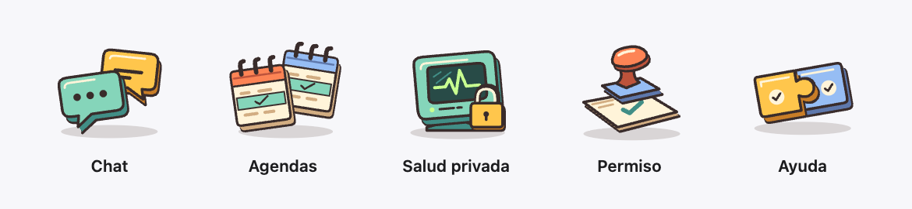

# Diseño de Ronda

Esta es la única dirección visual del proyecto. Mati la aprobó el 21-nov-2026 después de descartar
cinco (están en `archive/`, no se usan). **Toda pantalla, slide o gráfico del proyecto sigue este
documento.** Si algo no está acá, no se inventa: se pregunta a Mati o se agrega acá primero.

## Antes de tocar UI: 4 pasos

1. Abre `design/reference.html` en el navegador. Así se ve Ronda.
2. Carga `design/tokens.css` y `design/ronda.css` en tu pantalla. Arma todo con las clases `rd-*`.
3. Si te falta una pieza, agrégala a `ronda.css` (y un token a `tokens.css` si hace falta) en un
   commit propio, y anótala en la tabla de primitivas de este documento.
4. Antes de terminar: corre `design/lint.sh`, saca una captura de tu pantalla y ponla al lado de
   `design/reference.png`. Tienen que parecer la misma app.

## Demos e ilustraciones de producto

Todo lo que muestra el producto funcionando sin ser el producto (hero animado, pantallas del
pitch, recorridos con cursor, teléfonos con una conversación) se hace con la skill **Stageshow**
(`.agents/skills/stageshow/`, AGENTS.md regla 4). Este documento manda en el look; Stageshow manda
en el oficio: encuadre, recorte, ritmo y revisión cuadro a cuadro.

## La idea en una frase

**Los agentes viven en O(n²). Tú vives en O(1).** Muchas conexiones delgadas de fondo, y una sola
cosa brillante al frente: tu decisión. Todo el diseño dice eso.

## Los 7 principios

| # | Principio | En la práctica |
|---|---|---|
| 1 | **Luz, no tinta.** | Fondo casi blanco con un aura de color difuminada. Nada de bloques de color sólido ni fondos negros. |
| 2 | **Vidrio.** | Toda tarjeta, chip y píldora es translúcida (`rd-glass`), sin bordes oscuros. |
| 3 | **El degradado es para lo que importa.** | Solo en cuatro lugares (ver abajo). Si todo brilla, nada brilla. |
| 4 | **Una decisión por pantalla.** | Una sola tarjeta `rd-decision`, con un botón primario. |
| 5 | **Números tipo Apple Health.** | Número grande redondeado, unidad chica y gris, etiqueta chica arriba. |
| 6 | **Tipografía de sistema, un solo peso.** | SF Pro. Peso 600 para todo lo que no es texto corrido. Nunca 700, 800 ni cursiva. |
| 7 | **Personas con cara.** | Donde aparece un nombre, aparece su cara. Nunca un nombre suelto ni una inicial. |

## El degradado: dónde sí y dónde no

Azul → violeta → rosa → rojo → naranjo (`--rd-gradient`).

**Sí, solo acá:**

1. La segunda línea del titular de la pantalla (`rd-gradient-text`).
2. El borde de la tarjeta de decisión y su etiqueta.
3. Las líneas del grafo que están negociando ahora.
4. El número que representa «lo tuyo» frente a «lo de los agentes» (el `1` de «1 decisión»).

**No:** botones, fondos de tarjeta, íconos, texto corrido, bordes de otras tarjetas, gráficos de
datos. El isotipo usa su propio degradado cálido y es el único otro lugar con color.

## Color

Todos los valores están en `tokens.css`. No se escribe un color a mano en ningún otro archivo.

| Token | Para qué |
|---|---|
| `--rd-bg` | Fondo de toda pantalla. |
| `--rd-ink` | Texto principal y botón primario. |
| `--rd-muted` | Texto secundario, unidades, etiquetas. |
| `--rd-glass`, `--rd-glass-solid` | Superficie de tarjetas. La sólida es solo para la de decisión. |
| `--rd-gradient` | Ver arriba. |
| `--rd-aura-*` | Las cuatro manchas del fondo. Solo dentro de `rd-aura`. |
| `--rd-live` | El punto verde «en línea». Nada más es verde. |

No hay color por persona, ni rojo de error, ni amarillo de alerta. Si una pantalla necesita un
estado nuevo (error, alerta), se define acá antes de usarlo.

## Tipografía

| Uso | Clase | Tamaño | Peso |
|---|---|---|---|
| Titular de pantalla (uno) | `rd-hero` | 62 px | 600 |
| Frase de la decisión | `rd-title` | 24 px | 600 |
| Número grande | `rd-stat` | 40 px, SF Pro Rounded | 600 |
| Texto corrido | (base de `rd-page`) | 17 px | 400 |
| Nombre de persona, botón | `rd-person__name`, `rd-button` | 16 px | 600 |
| Etiqueta, estado, pie | `rd-label`, `rd-note` | 13 px | 600 / 400 |

Sin mayúsculas sostenidas, sin cursiva, sin subrayados, sin serif. El texto va alineado a la
izquierda; solo se centran los nombres bajo una cara.

## Primitivas (`ronda.css`)

| Clase | Qué es | Reglas |
|---|---|---|
| `rd-page` + `rd-page__inner` | Contenedor de toda pantalla. | Siempre el elemento raíz. |
| `rd-aura` | Las cuatro manchas de color del fondo (`<i>` × 4). | Una por pantalla, primer hijo de `rd-page`. |
| `rd-bar`, `rd-brand`, `rd-mark` | Barra superior con isotipo y nombre. | Isotipo: `logo/ronda-mark.svg`, sin modificar. |
| `rd-hero`, `rd-title`, `rd-label`, `rd-note` | Texto. | Ver tabla de tipografía. |
| `rd-gradient-text` | Texto con degradado. | Solo en los cuatro lugares permitidos. |
| `rd-glass` | Superficie de vidrio. | Se combina con `rd-card` o `rd-chip`. |
| `rd-card`, `rd-card--split` | Tarjeta bento. La `--split` tiene dos mitades. | Siempre con `rd-glass`. Radio 28 px. |
| `rd-decision` (+ `__body`, `__label`) | La tarjeta de la decisión. | Una por pantalla. |
| `rd-actions`, `rd-button`, `rd-button--quiet` | Botones píldora. | Un primario (negro) por pantalla. El resto, `--quiet`. |
| `rd-stat`, `rd-stat__unit`, `rd-stat-row` | Número grande con unidad. | Siempre con una `rd-label` arriba. |
| `rd-chip`, `rd-chip--status`, `rd-dot` | Chip de vidrio y píldora de estado. | Frases cortas, sin punto final. |
| `rd-face` (`--small`, `--tiny`), `rd-person` | Cara y nombre con estado. | Siempre juntos. |
| `rd-graph`, `rd-node`, `rd-edge*` | El grafo de agentes en 2D (referencia). | El grafo de la demo es el globo de `grafo/globo.html`, ver abajo. |
| `rd-input`, `rd-row`, `rd-code` | Campo de texto, fila de lista con divisor y bloque de código. | Para pantallas de configuración. El código usa `--rd-font-mono`, nada más lo usa. |
| `rd-mini`, `rd-mini-link` | Miniatura de una interacción sobre su conexión. | Un objeto, un gesto reconocible y su ejemplo ampliado. |
| `rd-player`, `rd-player__position`, `rd-player__time` | Controles de una escena. | Pausa y repetición, avance de izquierda a derecha y tiempo transcurrido. |
| `rd-layout`, `rd-stack` | Dos columnas: contenido y columna de tarjetas de 392 px. | En teléfono queda una columna. |

## Caras

- Son **Vita Faces**, una por persona, ya compuestas en `faces/*.png` (fondo pastel incluido).
- No se usan fotos reales, iniciales, emojis ni avatares generados de otro estilo.
- Una persona nueva: se compone otra Vita Face con las partes de `vita-front`
  (`public/vita-faces`, escala 1,32 y origen Y 74 %) y se agrega a `faces/`.
- Las caras actuales no buscan parecerse a cada integrante.

## Grafo de agentes: el globo

Aprobado por Mati el 21-nov-2026 («ESTA INCREÍBLE»). Página de trabajo: `grafo/globo.html`
(fuente: `grafo/globo.dc.html`; capturas: `grafo/globo-5.png` … `globo-300.png`). Se abre con
`?n=5|10|50|300` para fijar un tamaño y `&still` para una captura sin animación.

**Qué es:**

- Un globo de vidrio en 3D, dibujado en `<canvas>` con perspectiva propia (sin librerías). Las
  personas viven sobre la esfera; cada conversación posible es un arco que pasa por encima de la
  superficie.
- **Profundidad gradual** (nunca «sí/no»): cada cara se desenfoca, se aclara con niebla y pierde
  sombra de forma continua según su profundidad (`smoothstep` sobre z); los nombres también se
  desvanecen. Encima del fondo va el brillo del vidrio, que se desplaza lento, y un borde blanco.
- **Toda persona tiene cara.** El equipo usa sus Vita Faces (`faces/*.png`); el resto sale de un
  atlas de 64 Vita Faces compuestas con las piezas de `vita-front` (`faces/atlas/faces.png`, 8 × 8
  de 128 px) y su gemelo desenfocado para el fondo (`faces/atlas/faces-blur.png`). Cerca del borde
  del globo las caras se achican para no amontonarse.
- **Escala desde datos**, no a mano:
  - 5 personas: pentágono con caras, nombre y estado al costado (como la referencia).
  - 10, 50, 300: esfera (espiral de ángulo áureo). La cámara retrocede, las líneas se adelgazan.
    Con 300 las 44.850 líneas son una neblina de luz dentro del globo. Nunca una mancha oscura.
- **Grupos negociando a la vez** (2 con 5 personas, 3 con 10, 6 con 50, 10 con 300), de 3 a 6
  personas. Cada grupo conversa en dos rondas (AGENT_MODEL): primero quien pide ayuda habla con
  cada ayudante; después los ayudantes cercanos se hablan entre sí.
- **A lo más un grupo con color a la vez** (Mati, 21-nov). Por defecto es el tuyo (Tú, Ian, Lian,
  con chips); si tocas otro, ese pasa a color y el tuyo a tinta. Los demás grupos van en tinta
  neutra: líneas grises finas y aro gris en sus miembros. El grupo con color lleva líneas con
  degradado y halo, y un aro con degradado que gira lento en cada miembro.
- **Vida de un grupo** (los neutros; el de color se queda negociando):
  - nace: los hilos salen de quien pide ayuda con una punta de luz; cada cara se acerca un poco
    cuando su hilo la alcanza; luego aparecen los hilos de la segunda ronda;
  - negocia: una estela suave recorre cada hilo (blanca en el de color, tinta en los neutros);
  - acuerdo: los hilos se recogen hacia quien pidió ayuda, que se ilumina suave, y aparece un chip
    «Listo» con check; después el grupo se apaga y reaparece en otro sector del globo.
- **Interacción:**
  - Arrastrar gira el globo (con inercia; a los 4 s sin tocarlo vuelve solo).
  - Pasar el cursor por una persona enciende sus n − 1 conversaciones y un chip con su nombre.
  - Tocar a alguien con aro destaca su grupo: el globo gira para dejarlo al frente, el resto se
    atenúa, aparece el tema sobre el grupo y una tarjeta a la derecha con el tema, cada miembro con
    cara, nombre y rol («Pide ayuda» / «Puede ayudar»), y «N agentes, M conversaciones. Nadie más se
    entera.». Tocar fuera o «Cerrar» lo suelta.
- Se reproduce solo 5 → 10 → 50 → 300; tocar un tamaño o un grupo lo detiene.
- `prefers-reduced-motion`: sin vaivén, sin luz que recorre, sin nacimientos ni destellos; todo
  cambio es inmediato.

**Sigue abierto** (proponer y preguntar):

- Paso de «negociando» a «acuerdo», y el rearmado en vivo cuando alguien retira su disponibilidad.
- Dirección de las conexiones (flechas de quién le pide a quién, invertir una).
- Versión para teléfono y el componente real en `frontend/` (React), con sus primitivas `rd-*`.
- Ensayo con Stageshow (`film.mjs --gate`) y su `REHEARSAL.md`.

## Texto de la interfaz

- Español de Chile, tuteo, frases cortas. Se habla desde el lado de la persona: «Tu decisión de
  hoy», no «Propuesta generada».
- Los botones dicen lo que pasa: «Aceptar», «Ajustar».
- Sin signos de exclamación, sin emojis, sin jerga técnica en pantalla (nada de «agente
  coordinador», «payload», «sync»).
- Horas en formato 24 h con dos puntos (`10:30`). Miles con punto (`44.850`).
- Lo privado se dice: «No sale de tu agente.»

## Movimiento

En las pantallas generales, la animación continua es la luz que recorre las conexiones activas. La coreografía de las miniaturas está en rediseño. Lo demás aparece sin
rebotes ni giros. Se respeta `prefers-reduced-motion`.

### Miniaturas de interacción · en rediseño

**Mati rechazó la primera ejecución visual.** La lámina y las especificaciones de esta sección documentan la versión existente para poder reemplazarla. El encargo vigente está en el [handoff de miniaturas](HANDOFF_MINIATURAS.md).

Archivo de la primera ejecución e integración técnica

[Globo con actividades](grafo/globo.html?n=5) · [Vista ampliada de los cinco objetos](motion/minis.html)

En el grafo se ven varias acciones a la vez. Cada una se lee por la silueta y por el
movimiento de un objeto físico. La referencia que pidió Mati es el estilo chunky de
PostHog: objetos pequeños de escritorio, con volumen, color local y una mecánica reconocible.

- **Superficies.** Dibujar frente, canto y cara superior. La luz viene de arriba a la izquierda.
  Usar contorno de tinta cálida, brillo corto en el bisel y sombra de contacto suave. Las tapas
  esmaltadas, las hojas de papel y el cristal del monitor tienen acabados distintos. Los colores
  están en los tokens `--rd-mini-*`. Esta paleta se usa en los objetos del grafo.
- **Escala.** Diseñar para leer primero la silueta a 48–88 px. Los detalles explican la acción al
  acercarse. El nombre queda por fuera del objeto y la conexión pasa por debajo. Las caras de las
  personas conservan espacio propio.
- **Movimiento.** Cada mini repite preparación, acción y reposo. Desfasar los inicios para que
  se vean conversaciones independientes. Mantener inmóvil el anclaje al grafo, mover las partes
  del objeto. Pausar conserva la fase actual. Con movimiento reducido se ve el resultado quieto.
- **Significados.** Chat alterna dos bocadillos. Calendarios alinea una ranura de ambas agendas.
  Salud lee en el monitor y cierra el candado. Permisos estampa la autorización antes de que salga
  el papel. Ayuda encaja dos piezas después de que ambas aceptan. Las miniaturas compartidas
  representan la actividad con símbolos y prescinden de valores personales.

En la demo de cinco agentes se dibuja un objeto en cada uno de cinco arcos activos. Al pasar a
10, 50 o 300 se muestran las dos conversaciones destacadas del globo. Cada objeto calcula su
posición sobre la misma curva que se dibuja en el canvas. Si dos proyecciones se superponen al
girar, la miniatura se aparta y un trazo fino conserva el anclaje al arco. Al seleccionarla se
abre la escena completa. La vista ampliada permite comparar las cinco acciones con la red quieta.

La primitiva reutilizable es `<ronda-mini kind="calendars" class="rd-mini">`. Los tipos son
`chat`, `calendars`, `health`, `permission` y `help`. Cada uno acepta los atributos booleanos
`paused` (congela el cuadro) y `poster` (muestra el resultado). Un anfitrión puede ajustar
`--mini-size`, `--mini-cycle` y `--mini-delay`. La geometría y los gestos se editan en
`grafo/mini/objects.js`. La integración con la cámara está en `grafo/mini/globe.js`.
Después de editar, ejecutar `python3 design/grafo/mini/build.py` desde la raíz para actualizar
el HTML portátil y las dos fuentes del globo. El ensayo está en [REHEARSAL.md](motion/REHEARSAL.md).

## Lo que no se hace

Cada punto es una dirección que Mati ya rechazó.

- Fondo negro u oscuro. Bloques de color sólido. Bordes negros gruesos.
- Tipografía serif (Instrument Serif u otra). Mayúsculas espaciadas tipo etiqueta.
- Grillas tipo Mondrian, círculos de metro, sellos circulares, estética «retro».
- Copiar Montu: tarjetas gris opaco `#f5f5f7` sobre blanco, avatares de arcilla 3D, un color por
  persona. Ronda comparte con Montu solo el bento redondeado y los números tipo Apple Health.
- Degradado morado genérico de «app de IA» en botones o fondos.

## Decisiones

| Fecha | Decisión | Quién |
|---|---|---|
| 21-nov-2026 | Dirección «Aura»: luz tipo Apple Intelligence, vidrio, bento, red de agentes al centro. | Mati |
| 21-nov-2026 | Se conserva de Montu: tarjetas bento redondeadas y números tipo Apple Health. | Mati |
| 21-nov-2026 | Caras: Vita Faces (alternativas mencionadas: estilo Notion o fotos reales; no elegidas). | Mati |
| 21-nov-2026 | Se piden miniaturas simultáneas en las conexiones y la referencia chunky 3D de PostHog. Mati rechaza la primera ejecución de las cinco piezas. Rediseño pendiente. | Mati |
| 21-nov-2026 | El grafo queda abierto: «necesita trabajo». | Mati |
| 21-nov-2026 | Grafo con anillo/nube en 2D: descartado («horrible»). | Mati |
| 21-nov-2026 | Globo: grupos de 3 a 6 en dos rondas; a lo más un grupo con color; desenfoque gradual por profundidad; sin «burbuja» de acuerdo: hilos que se recogen, brillo y chip «Listo». | Mati |
| 21-nov-2026 | Globo: cara en todos los nodos, nodos de atrás desenfocados bajo un velo de vidrio, varios grupos negociando con aro de grupo, tocar un grupo lo destaca, efectos de nacimiento y acuerdo. | Mati |
| 21-nov-2026 | Grafo = globo de vidrio en 3D: escala 5 → 300 desde datos, solo tus conversaciones con cara y degradado, se arrastra para girar y se resalta una persona al pasar el cursor. | Mati |

Abierto: nombre definitivo («Ronda» es provisorio) e isotipo definitivo (el actual, tres órbitas y
un punto, todavía no lo revisó Mati en grande).

## Archivos

| Archivo | Qué es |
|---|---|
| `DESIGN.md` | Este documento. La regla. |
| `tokens.css` | Colores, tipografía, radios, sombras, espacios. |
| `ronda.css` | Primitivas `rd-*`. |
| `reference.html`, `reference.png` | La pantalla de referencia, hecha solo con primitivas, y su captura. |
| `logo/ronda-mark.svg` | Isotipo. |
| `faces/` | Caras del equipo. |
| `lint.sh` | Revisa que ningún archivo de UI se salga de los tokens. |
| `canvas/` | Fuente del tablero en el canvas de diseño. |
| `archive/` | Direcciones descartadas. No usar. |
