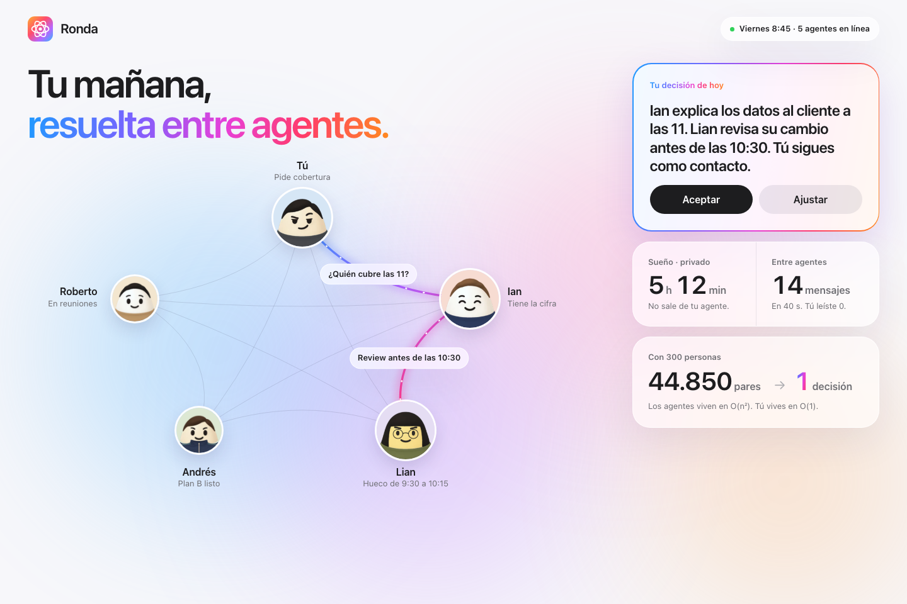

# Diseño de Ronda

Esta es la única dirección visual del proyecto. Mati la aprobó el 21-nov-2026 después de descartar
cinco (están en `archive/`, no se usan). **Toda pantalla, slide o gráfico del proyecto sigue este
documento.** Si algo no está acá, no se inventa: se pregunta a Mati o se agrega acá primero.

## Antes de tocar UI: 4 pasos

1. Abre `design/reference.html` en el navegador. Así se ve Ronda.
2. Carga `design/tokens.css` y `design/ronda.css` en tu pantalla. Arma todo con las clases `rd-*`.
3. Si te falta una pieza, agrégala a `ronda.css` (y un token a `tokens.css` si hace falta) en un
   commit propio, y anótala en la tabla de primitivas de este documento.
4. Antes de terminar: corre `design/lint.sh`, saca una captura de tu pantalla y ponla al lado de
   `design/reference.png`. Tienen que parecer la misma app.

## Demos e ilustraciones de producto

Todo lo que muestra el producto funcionando sin ser el producto (hero animado, pantallas del
pitch, recorridos con cursor, teléfonos con una conversación) se hace con la skill **Stageshow**
(`.agents/skills/stageshow/`, AGENTS.md regla 4). Este documento manda en el look; Stageshow manda
en el oficio: encuadre, recorte, ritmo y revisión cuadro a cuadro.

## La idea en una frase

**Los agentes viven en O(n²). Tú vives en O(1).** Muchas conexiones delgadas de fondo, y una sola
cosa brillante al frente: tu decisión. Todo el diseño dice eso.

## Los 7 principios

| # | Principio | En la práctica |
|---|---|---|
| 1 | **Luz, no tinta.** | Fondo casi blanco con un aura de color difuminada. Nada de bloques de color sólido ni fondos negros. |
| 2 | **Vidrio.** | Toda tarjeta, chip y píldora es translúcida (`rd-glass`), sin bordes oscuros. |
| 3 | **El degradado es para lo que importa.** | Solo en cuatro lugares (ver abajo). Si todo brilla, nada brilla. |
| 4 | **Una decisión por pantalla.** | Una sola tarjeta `rd-decision`, con un botón primario. |
| 5 | **Números tipo Apple Health.** | Número grande redondeado, unidad chica y gris, etiqueta chica arriba. |
| 6 | **Tipografía de sistema, un solo peso.** | SF Pro. Peso 600 para todo lo que no es texto corrido. Nunca 700, 800 ni cursiva. |
| 7 | **Personas con cara.** | Donde aparece un nombre, aparece su cara. Nunca un nombre suelto ni una inicial. |

## El degradado: dónde sí y dónde no

Azul → violeta → rosa → rojo → naranjo (`--rd-gradient`).

**Sí, solo acá:**

1. La segunda línea del titular de la pantalla (`rd-gradient-text`).
2. El borde de la tarjeta de decisión y su etiqueta.
3. Las líneas del grafo que están negociando ahora.
4. El número que representa «lo tuyo» frente a «lo de los agentes» (el `1` de «1 decisión»).

**No:** botones, fondos de tarjeta, íconos, texto corrido, bordes de otras tarjetas, gráficos de
datos. El isotipo usa su propio degradado cálido y es el único otro lugar con color.

## Color

Todos los valores están en `tokens.css`. No se escribe un color a mano en ningún otro archivo.

| Token | Para qué |
|---|---|
| `--rd-bg` | Fondo de toda pantalla. |
| `--rd-ink` | Texto principal y botón primario. |
| `--rd-muted` | Texto secundario, unidades, etiquetas. |
| `--rd-glass`, `--rd-glass-solid` | Superficie de tarjetas. La sólida es solo para la de decisión. |
| `--rd-gradient` | Ver arriba. |
| `--rd-aura-*` | Las cuatro manchas del fondo. Solo dentro de `rd-aura`. |
| `--rd-live` | El punto verde «en línea». Nada más es verde. |

No hay color por persona, ni rojo de error, ni amarillo de alerta. Si una pantalla necesita un
estado nuevo (error, alerta), se define acá antes de usarlo.

## Tipografía

| Uso | Clase | Tamaño | Peso |
|---|---|---|---|
| Titular de pantalla (uno) | `rd-hero` | 62 px | 600 |
| Frase de la decisión | `rd-title` | 24 px | 600 |
| Número grande | `rd-stat` | 40 px, SF Pro Rounded | 600 |
| Texto corrido | (base de `rd-page`) | 17 px | 400 |
| Nombre de persona, botón | `rd-person__name`, `rd-button` | 16 px | 600 |
| Etiqueta, estado, pie | `rd-label`, `rd-note` | 13 px | 600 / 400 |

Sin mayúsculas sostenidas, sin cursiva, sin subrayados, sin serif. El texto va alineado a la
izquierda; solo se centran los nombres bajo una cara.

## Primitivas (`ronda.css`)

| Clase | Qué es | Reglas |
|---|---|---|
| `rd-page` + `rd-page__inner` | Contenedor de toda pantalla. | Siempre el elemento raíz. |
| `rd-aura` | Las cuatro manchas de color del fondo (`<i>` × 4). | Una por pantalla, primer hijo de `rd-page`. |
| `rd-bar`, `rd-brand`, `rd-mark` | Barra superior con isotipo y nombre. | Isotipo: `logo/ronda-mark.svg`, sin modificar. |
| `rd-hero`, `rd-title`, `rd-label`, `rd-note` | Texto. | Ver tabla de tipografía. |
| `rd-gradient-text` | Texto con degradado. | Solo en los cuatro lugares permitidos. |
| `rd-glass` | Superficie de vidrio. | Se combina con `rd-card` o `rd-chip`. |
| `rd-card`, `rd-card--split` | Tarjeta bento. La `--split` tiene dos mitades. | Siempre con `rd-glass`. Radio 28 px. |
| `rd-decision` (+ `__body`, `__label`) | La tarjeta de la decisión. | Una por pantalla. |
| `rd-actions`, `rd-button`, `rd-button--quiet` | Botones píldora. | Un primario (negro) por pantalla. El resto, `--quiet`. |
| `rd-stat`, `rd-stat__unit`, `rd-stat-row` | Número grande con unidad. | Siempre con una `rd-label` arriba. |
| `rd-chip`, `rd-chip--status`, `rd-dot` | Chip de vidrio y píldora de estado. | Frases cortas, sin punto final. |
| `rd-face` (`--small`, `--tiny`), `rd-person` | Cara y nombre con estado. | Siempre juntos. |
| `rd-graph`, `rd-node`, `rd-edge*` | El grafo de agentes. | **En trabajo**, ver abajo. |
| `rd-input`, `rd-row`, `rd-code` | Campo de texto, fila de lista con divisor y bloque de código. | Para pantallas de configuración. El código usa `--rd-font-mono`, nada más lo usa. |
| `rd-player`, `rd-player__position`, `rd-player__time` | Controles de una escena. | Pausa y repetición, avance de izquierda a derecha y tiempo transcurrido. |
| `rd-layout`, `rd-stack` | Dos columnas: contenido y columna de tarjetas de 392 px. | En teléfono queda una columna. |

## Caras

- Son **Vita Faces**, una por persona, ya compuestas en `faces/*.png` (fondo pastel incluido).
- No se usan fotos reales, iniciales, emojis ni avatares generados de otro estilo.
- Una persona nueva: se compone otra Vita Face con las partes de `vita-front`
  (`public/vita-faces`, escala 1,32 y origen Y 74 %) y se agrega a `faces/`.
- Las caras actuales no buscan parecerse a cada integrante.

## Grafo de agentes (en trabajo)

Mati: «el grafo necesita trabajo». Lo que **ya está decidido**:

- Las personas son nodos con su cara. Las conexiones son curvas delgadas, no rectas.
- Conexión en reposo: 1 px, gris translúcido (`rd-edge`).
- Conexión negociando: degradado, 3,5 px, con un halo difuminado y un punto de luz que la recorre
  (`rd-edge--glow`, `rd-edge--live`, `rd-edge--spark`).
- Sobre una conexión activa va un `rd-chip` con lo que se negocia, en pocas palabras.
- El grafo no va dentro de una caja: flota sobre el aura.

Lo que **está abierto** (no lo cierres por tu cuenta; propón y pregunta):

- La disposición de los nodos (hoy es un pentágono fijo, hecho a mano).
- Cómo se ve con 50 o 300 personas.
- Cómo se anima el paso de «negociando» a «acuerdo» y el rearmado cuando alguien se retira.

## Texto de la interfaz

- Español de Chile, tuteo, frases cortas. Se habla desde el lado de la persona: «Tu decisión de
  hoy», no «Propuesta generada».
- Los botones dicen lo que pasa: «Aceptar», «Ajustar».
- Sin signos de exclamación, sin emojis, sin jerga técnica en pantalla (nada de «agente
  coordinador», «payload», «sync»).
- Horas en formato 24 h con dos puntos (`10:30`). Miles con punto (`44.850`).
- Lo privado se dice: «No sale de tu agente.»

## Movimiento

Una sola animación continua: la luz que recorre las conexiones activas. Lo demás aparece sin
rebotes ni giros. Se respeta `prefers-reduced-motion`.

## Lo que no se hace

Cada punto es una dirección que Mati ya rechazó.

- Fondo negro u oscuro. Bloques de color sólido. Bordes negros gruesos.
- Tipografía serif (Instrument Serif u otra). Mayúsculas espaciadas tipo etiqueta.
- Grillas tipo Mondrian, círculos de metro, sellos circulares, estética «retro».
- Copiar Montu: tarjetas gris opaco `#f5f5f7` sobre blanco, avatares de arcilla 3D, un color por
  persona. Ronda comparte con Montu solo el bento redondeado y los números tipo Apple Health.
- Degradado morado genérico de «app de IA» en botones o fondos.

## Decisiones

| Fecha | Decisión | Quién |
|---|---|---|
| 21-nov-2026 | Dirección «Aura»: luz tipo Apple Intelligence, vidrio, bento, red de agentes al centro. | Mati |
| 21-nov-2026 | Se conserva de Montu: tarjetas bento redondeadas y números tipo Apple Health. | Mati |
| 21-nov-2026 | Caras: Vita Faces (alternativas mencionadas: estilo Notion o fotos reales; no elegidas). | Mati |
| 21-nov-2026 | El grafo queda abierto: «necesita trabajo». | Mati |

Abierto: nombre definitivo («Ronda» es provisorio) e isotipo definitivo (el actual, tres órbitas y
un punto, todavía no lo revisó Mati en grande).

## Archivos

| Archivo | Qué es |
|---|---|
| `DESIGN.md` | Este documento. La regla. |
| `tokens.css` | Colores, tipografía, radios, sombras, espacios. |
| `ronda.css` | Primitivas `rd-*`. |
| `reference.html`, `reference.png` | La pantalla de referencia, hecha solo con primitivas, y su captura. |
| `logo/ronda-mark.svg` | Isotipo. |
| `faces/` | Caras del equipo. |
| `lint.sh` | Revisa que ningún archivo de UI se salga de los tokens. |
| `canvas/` | Fuente del tablero en el canvas de diseño. |
| `archive/` | Direcciones descartadas. No usar. |
