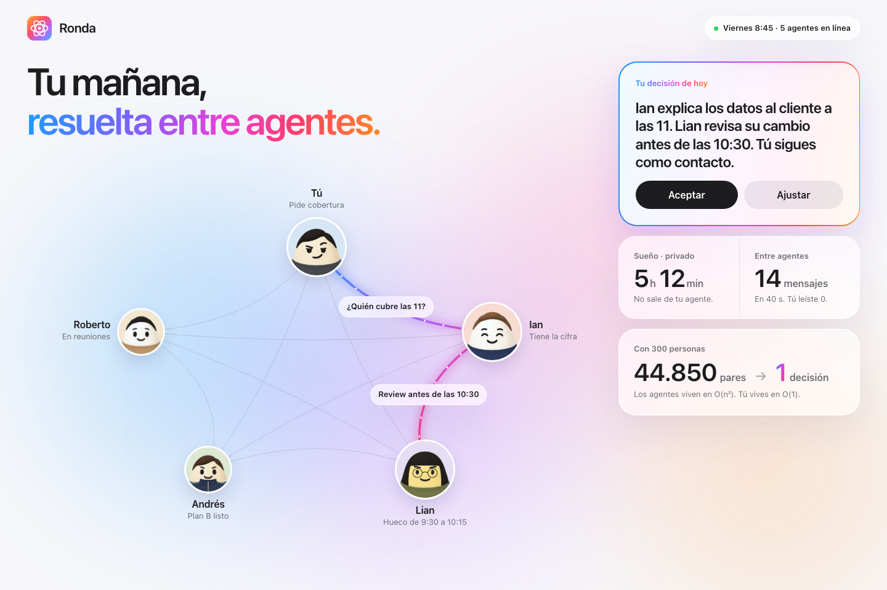

# Diseño

Dirección visual de la hack. Nombre provisorio: «Ronda».

- Canvas: https://claude.ai/artifact/QPk6jLqdms2aaF1x85ejjq
- **En revisión: «Aura · 8:45»** (`Aura.dc.html`, captura en `aura.png`). Es «La red» (`Red.dc.html`,
  `red.png`) refinada con la luz de Apple Intelligence: fondo con aura de color, tarjetas de vidrio,
  líneas curvas delgadas, titular con degradado e isotipo de tres órbitas y un punto.
  - Lo propio: la red de agentes al centro. Las caras son los nodos y las líneas entre quienes
    están negociando se encienden con un degradado animado.
  - Bento: tarjetas blancas redondeadas sobre fondo gris claro, tipografía de sistema Apple,
    números grandes tipo Apple Health.
  - Caras: Vita Faces compuestas desde las partes de `vita-front` (`design/faces/`).
- Descartadas por Mati: A, B, C, D y E (`Hoy.dc.html`, que era una copia de Montu).
- Logo: pendiente hasta cerrar el look de la pantalla.
