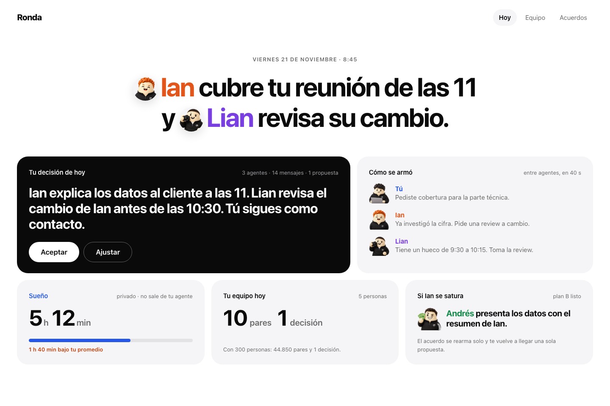

# Diseño

Dirección visual de la hack. Nombre provisorio: «Ronda».

- Canvas: https://claude.ai/artifact/QPk6jLqdms2aaF1x85ejjq
- **En revisión: «Hoy · 8:45»** (`Hoy.dc.html`, captura en `hoy.png`). Sigue el look de Montu:
  fondo blanco, tipografía de sistema Apple, tarjetas bento gris claro con esquinas de 26 px,
  una tarjeta negra para la decisión, avatares 3D del equipo, un color por persona y números
  grandes tipo Apple Health.
- Descartadas por Mati: A, B, C y D (los demás `.dc.html`).
- Logo: pendiente hasta cerrar el look de la pantalla.
