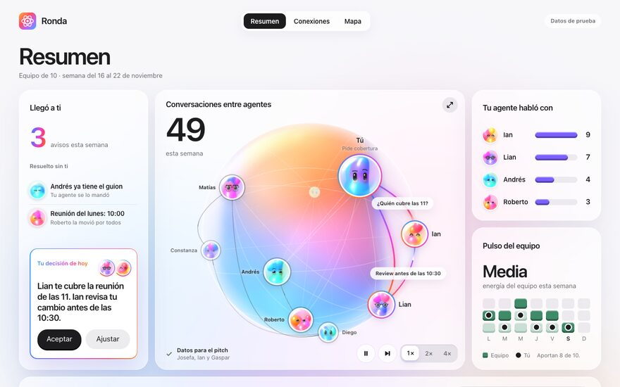

# Diseño

**Empieza por [`DESIGN.md`](DESIGN.md).** Es la regla de toda la UI del proyecto.

**Miniaturas del grafo en rediseño.** El [handoff para diseño](HANDOFF_MINIATURAS.md) recoge el feedback de Mati y dónde retomar.

**El estándar es `contexto/`** (Resumen, Conexiones, Mapa). **[`index.html`](index.html) es el mapa** de todo lo que hay acá y en qué estado está: ábrelo primero.

- `tokens.css` y `ronda.css`: tokens y primitivas. Toda pantalla se arma con ellos.
- `index.html`: el mapa de las superficies. Sírvelo con `python3 design/serve.py` y abre `http://127.0.0.1:4188/`.
- `contexto/`: el estándar. `grafo/universo.html` y `grafo/hilo/`: la demo.
- `reference.html`: referencia anterior. No es el estándar.
- `lint.sh`: revisa que la UI no se salga del sistema.
- `logo/`, `faces/`: isotipo y caras.
- `canvas/`: fuente del tablero en el canvas, https://claude.ai/artifact/QPk6jLqdms2aaF1x85ejjq
- `archive/`: direcciones descartadas. No usar.
