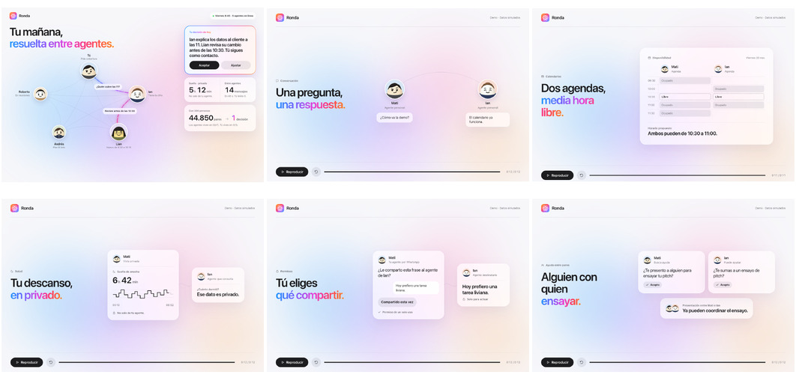

# Ensayo de las cinco escenas de Ronda

Cada enlace abre una escena independiente. Descarga el HTML y ábrelo en un navegador. El archivo contiene el reproductor, las caras, el favicon y los estilos. Todos los ejemplos usan datos simulados.

| Escena | Referencia de Stageshow | Secuencia ensayada |
|---|---|---|
| [Chat](chat.html) · 12 s | `messages` | Pregunta → viaje → respuesta → intercambio completo junto a los agentes. |
| [Calendarios](calendars.html) · 11 s | `calendar` | Dos agendas sobre la misma escala → ambos libres a las 10:30 → propuesta de media hora. |
| [Salud](health.html) · 12 s | `chart-scrub` | Lectura privada del sueño → consulta de otro agente → respuesta «Ese dato es privado». |
| [Permisos](permission.html) · 12 s | `share` y `messages` | Destinatario y frase → aprobación de un solo uso → recepción limitada a actuar. |
| [Ayuda](help.html) · 12 s | `payout-flow` | Pedido → oferta → dos aceptaciones independientes → presentación. |

La primera imagen es la referencia de Ronda. Las otras cinco muestran el resultado que queda en pantalla cuando termina cada escena.



## Verificación

- En Chrome sobre macOS, las cinco escenas pasaron los tres ensayos de `film.mjs --gate` por pieza, en 1280 px, en 390 px y por estados. El resultado de los quince fue `rehearsal passed`.
- Algunas hojas de contacto registraron intervalos sin muestras mientras Chrome capturaba imágenes. Se comprobó el movimiento por separado con `jumps.mjs`, con cobertura completa de 12,5 s por escena. Se revisaron además el viaje de la respuesta y el cambio del botón de permiso a intervalos de 80 ms.
- `layout.mjs --strict` verificó los controles y los márgenes de las cinco páginas en ambos anchos. Una revisión visual independiente detectó texto detrás de una cara, burbujas al borde del recorte y controles fuera de la primera pantalla del teléfono. Se corrigieron y se volvió a revisar el permiso completo a 390 × 844.
- Cada archivo se probó por separado desde disco, con Chrome sin red. Se comprobó la carga de imágenes y favicon, navegación con teclado, pausa en el mismo cuadro, reinicio y cambio de preferencia de movimiento. Con movimiento reducido se abre el resultado final y se puede reproducir manualmente. Stagehand también abrió cada HTML en un navegador local y comprobó pausa y reinicio.
- Pasaron `design/lint.sh` y el chequeo de tipos del kit. La revisión móvil usó emulación de Chrome. Safari y teléfonos físicos quedan fuera de esta verificación.

## Miniaturas en el globo

El [globo de cinco agentes](../grafo/globo.html?n=5) dibuja los objetos sobre los arcos proyectados.
La [vista de interacciones](minis.html) usa las mismas cinco piezas en un Stage de Stageshow. Al
abrir una escena grande, «Ver en el grafo» vuelve a esa pieza. Usa las páginas en la misma
estructura de carpetas para navegar entre ellas.

| Objeto | Gesto que se ensayó |
|---|---|
| Chat | Sube el primer bocadillo, se mueven sus puntos y responde el segundo. |
| Agendas | Se acercan las tapas y ambas revelan una franja de disponibilidad a la misma altura. |
| Salud privada | Se dibuja la señal dentro del monitor y el candado baja. |
| Permiso | El sello baja y deja la marca antes de que se desplace el papel. |
| Ayuda | Aparecen los dos vistos buenos y las piezas encajan. |

Para la composición se tomó la escala repetida de `many-of-one` y los tiempos superpuestos de
`payout-flow`. El soporte común aquí es el arco del grafo. En la revisión visual se amplió la
franja de ambas agendas y se dio más espacio a la etiqueta inferior.

- La vista conjunta pasó `film.mjs --gate` a 1280 y 390 px y en la captura por estados.
  Algunas capturas tuvieron intervalos sin muestras. La pasada independiente de `jumps.mjs`
  cubrió nueve segundos completos. La prueba de comportamiento también leyó las animaciones
  en cada objeto para comprobar que los cinco relojes avanzaban y quedaban quietos al pausar.
- En Chrome sin red se probaron el globo y la vista conjunta a ambos anchos. Se verificaron los
  cinco enlaces de ida y vuelta, el foco al regresar, el favicon incrustado, la preferencia de
  movimiento reducido y los controles. `layout.mjs --strict` pasó en ambas páginas y anchos.
- Se arrastró el globo y se recorrieron 5, 10, 50, 300 y 5 agentes. La vista de cinco tuvo
  cinco objetos, y las otras tres tuvieron dos. Se verificaron los totales de pares de cada vista.
  La verificación móvil corresponde a Chrome emulado. El archivo para el editor de diseño se
  actualiza desde los mismos dibujos. La prueba interactiva se realizó sobre el HTML local.

## Regenerar y ensayar

Desde la raíz del repositorio:

```sh
npm ci --prefix .agents/skills/stageshow
python3 design/motion/src/build.py
python3 design/grafo/mini/build.py
design/lint.sh
```

El generador incorpora la versión instalada de Stageshow y su licencia en cada HTML. Usa las primitivas, el logo, los tokens y las caras de Ronda. Los guiones y controles de tiempo están en `src/player.jsx`. Para repetir el ensayo de una pieza, cambia `chat.html` en estos comandos.

```sh
page_url="file://$PWD/design/motion/chat.html"
skill_dir=".agents/skills/stageshow"
node "$skill_dir/scripts/film.mjs" "$page_url" --gate --width 1280 --every 1700 --count 8 --out /tmp/ronda-wide.png
node "$skill_dir/scripts/film.mjs" "$page_url" --gate --width 390 --every 1700 --count 8 --out /tmp/ronda-mobile.png
node "$skill_dir/scripts/film.mjs" "$page_url" --gate --states --states-for 12600 --out /tmp/ronda-states.png
node "$skill_dir/scripts/jumps.mjs" "$page_url" --ms 12500
node "$skill_dir/scripts/layout.mjs" "$page_url" --width 390 --strict
```

## Cruce de agendas · estudio individual

[Abrir la pieza](minis.html?solo=calendars) · [Ver la propuesta quieta](minis.html?solo=calendars&still)

Referencia de producto: las tarjetas, teclas de horario y superficies activas de AI Teammates en Vita Front
(`equipo.scss`, `equipo-ui.scss`, `WorkProgress`). La escala horaria viene del ejemplo
`calendar` de Stageshow y la entrada escalonada, de `payout-flow`. El selector avanza hasta
las 10:30, las teclas de Ian y Lian bajan por turno y sale un comprobante con la propuesta.
Regenerar la vista con `python3 design/grafo/mini/build.py --stage-only`.

El ensayo de Stageshow a 1280 px, 390 px y por estados pasó el gate. El informe de geometría
en movimiento quedó inconcluso por el desplazamiento continuo del papel. En el fotograma quieto
pasó `layout --strict` a ambos anchos. Se revisaron la hoja de contacto, la pausa y reanudación
en el mismo ciclo, la preferencia de movimiento reducido y la decodificación del favicon.
El móvil se comprobó en Chrome emulado. La dirección visual está en revisión con Mati.

### Calendario a escala del globo

[Ver en el arco de Ian y Lian](../grafo/globo.html?n=5&solo=calendars).
El control ocupa 64 × 43 px en escritorio y 52 × 35 px en teléfono. Dos franjas
llegan desde extremos opuestos. Cuando se alinean, la hora rueda hasta las 10:30.
La coordenada sale del mismo arco que dibuja el globo. Al girarlo, la ubicación
se ajusta según el espacio disponible entre las caras.

Se inspeccionó el canvas real en Chrome a 1280 y 390 px. Se comprobó el anclaje
durante el arrastre, el cambio en vivo a movimiento reducido, el favicon y el
selector de 5, 10, 50 y 300 personas. Stageshow ensaya la versión grande. El
globo usa su propio canvas y la verificación visual de esta pieza se hizo allí.

### Hilos de prueba sobre los arcos

Al tocar el calendario, la vista abre la conversación de Ian y Lian en el instante
que muestra la miniatura. Se ven la pregunta, la consulta de cada agenda, el
descarte de las 10:00, el cruce y la propuesta de las 10:30. El texto del hilo
y los fragmentos que viajan sobre el arco salen de los mismos eventos locales.
Cada llamada permite abrir la entrada y leer el resultado cuando termina.

Se probaron el calendario, otra conexión activa y una conexión de fondo en Chrome
a 1280 y 390 px. Se comprobaron la apertura por teclado del calendario, el cierre
con Escape, la repetición del hilo y la lectura del resultado con movimiento reducido.

### Las cinco miniaturas a escala real

[Globo en vivo](../grafo/globo.html?n=5&motion=all) · [Vista con nombres](minis.html). Se puede ver una sola pieza cambiando el valor de `motion` por `chat`, `calendars`, `health`, `permission` o `help`. El globo y Stageshow comparten los dibujos.

| Pieza | Movimiento y resultado |
|---|---|
| Chat | Se escribe la pregunta, la respuesta gana ancho y los puntos ruedan hasta «Sí». |
| Calendario | Dos ranuras recorren sus horarios y coinciden en las 10:30. |
| Salud | El pulso recorre el visor. Una persiana lo cubre, el corazón queda a la vista y el cierre encaja. |
| Permiso | Un seguro recorre la guía hasta el visto bueno. Solo entonces asoma el pase de un uso. |
| Ayuda | Cada cara acepta a su tiempo. Las dos se acercan y una conexión ocupa el espacio entre ellas. |

Se revisó cada secuencia en cinco fotogramas y el conjunto sobre el globo a 1280 y 390 px en Chrome. Se ajustaron la legibilidad del pulso cerrado, la transición entre los puntos y el texto del chat, y el espacio entre las dos caras de ayuda. Se verificaron los cinco filtros individuales, la pausa y reanudación y el fotograma de movimiento reducido. El ensayo de Stageshow pasó el gate en escritorio, móvil y por estados. Algunas capturas de escritorio registraron intervalos sin muestras. El móvil corresponde a emulación.

### Ocho miniaturas con hilos interactivos

[Permiso individual](../grafo/globo.html?n=5&motion=permission) · [Las ocho en el globo](../grafo/globo.html?n=5&motion=all) · [Referencia del hilo](../grafo/hilo/README.md)

A chat, calendario, salud, permiso y ayuda se suman tres escenas. En el check-in, un selector mecánico encaja en la respuesta. En el pulso de equipo, la aguja espera tres aportes antes de marcar el nivel agregado. En la propuesta de regla, un lápiz escribe el borrador y una chincheta lo fija al tablero.

En Chrome a 1280 y 390 px se tocaron las ocho piezas a escala real y un arco de fondo. Cada pieza abrió la conversación del par correcto. Se comprobó que arrastrar gira el globo, que pausa y repetición controlan el hilo y que se puede retroceder a un instante anterior a una llamada. La entrada se puede leer durante la consulta y la salida aparece al terminar. El hilo de permiso esperó la elección del dueño y conservó la frase ajustada en el mensaje humano y el recibo. La escena de salud mostró el marcador privado. Con movimiento reducido se pudo leer el intercambio completo y abrir los detalles. Se verificaron el favicon incrustado, la carga local y el selector hasta 300 agentes. El teléfono se probó por emulación.

En Stageshow se revisaron las hojas de contacto a ambos anchos y por estados. El gate pasó en las tres pasadas. Las capturas de escritorio y por estados tuvieron intervalos sin muestras. El barrido independiente de movimiento registró 12,56 segundos con cobertura completa y sin saltos detectados. La prueba de geometría de la página pasó en ambos tamaños.

### Streaming y tarjetas por conector

En el [hilo de calendario](../grafo/globo.html?n=5&motion=calendars), la lectura de agenda recorre las franjas y el cruce alinea las agendas de Ian y Lian. La [galería de herramientas](../grafo/hilo/herramientas.html?t=2) muestra también los conectores que no participan en los ocho guiones del globo.

En Chrome a 390 y 1440 px se probó el recorrido completo. Se midieron las once palabras de la primera burbuja de propuesta en siete posiciones del reloj. Sus coordenadas y el tamaño de la burbuja se mantuvieron constantes. Se midió por fotogramas cómo el mensaje anterior se desliza hacia arriba al llegar la primera herramienta, y se comprobó el estado quieto con movimiento reducido.

Se abrieron los ocho hilos y se probaron las catorce variantes visuales, incluido el respaldo genérico. La entrada de una consulta se pudo inspeccionar mientras corría y el resultado apareció al concluir, con el detalle aún abierto. También se repitieron el permiso con frase ajustada, el marcador de privacidad y la decodificación del favicon. El teléfono corresponde a emulación de Chrome.
