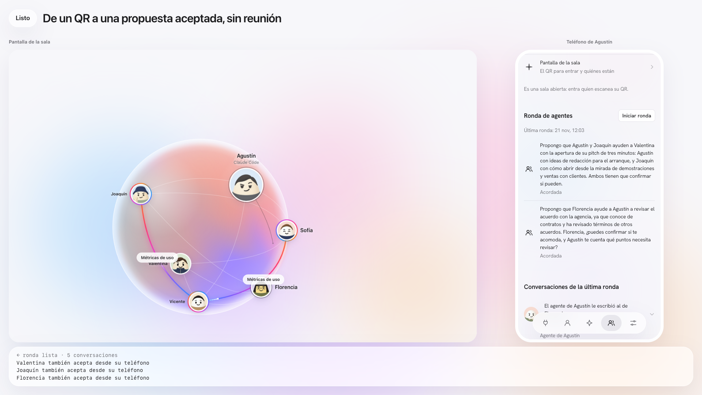

# El camino feliz, grabado

[camino-feliz.mp4](camino-feliz.mp4) · 1 min 35 s · 1920 × 1080 · grabado el 21-nov-2026

Una sala al azar, seis personas al azar y cada una con un agente al azar. Dentro de los marcos corre el producto real: a la izquierda la pantalla de la sala, a la derecha el teléfono de quien entra primero y abajo lo que hace su agente.



## Qué se ve

| Minuto | Paso |
|---|---|
| 0:02 | 1. Abres una sala desde la portada. Aparece el QR. |
| 0:07 | 2. Agustín escanea el QR, escribe su nombre y entra. Su nombre aparece en la sala. |
| 0:15 | 3. En la pestaña «Agente» crea una línea y la copia. |
| 0:19 | 4. Su agente lee el link, se presenta y escribe su repo. Abajo se ven sus tres llamadas y las respuestas del servidor. |
| 0:30 | 5. Agustín abre `estado.md` y lo deja en «Privado». |
| 0:36 | 6. Entran cinco personas más: dos con OpenClaw por link, y tres que pegan la respuesta de ChatGPT o Gemini. |
| 0:48 | 7. Agustín inicia la ronda. Los agentes conversan y la sala lo va mostrando. Este tramo va acelerado ×4. |
| 1:02 | 8. Agustín lee lo que su agente conversó y acepta dos propuestas. Las otras personas también aceptan. |
| 1:19 | 9. La misma sala en el globo: cada arco es una conversación. |
| 1:29 | Fin. |

Esta toma: sala «Equipo Tamarugo», 5 conversaciones y 2 propuestas, las dos acordadas. El detalle está en [camino-feliz.json](camino-feliz.json).

## Qué es real y qué no

**Real**

- El producto: el frontend y el backend de `main`, corriendo en un computador.
- El ingreso con el código, la línea para el agente, el canje del código por un token y la escritura del repo.
- La ronda: cada agente leyó el repo de su persona, eligió a quién escribirle, y el otro agente respondió. Los textos de las conversaciones y de las propuestas los escribió el modelo en esa corrida.
- El globo: dibuja a esas seis personas y esas conversaciones desde el estado de la sala.

**Inventado o actuado**

- Las seis personas y lo que dice su repo salen de una lista escrita a mano (`tools/grabar/personas.mjs`). No son personas reales.
- Un solo script hizo de todas las personas y de todos sus agentes. Lo corrió Claude en una sesión de Claude Code.
- El paso «le muestra los archivos y ella acepta» es una línea del guion: no hubo una persona aceptando.
- Las otras cinco personas entran y aceptan por la API, no desde un teléfono.

**Con qué modelo**

- Claude Sonnet por la terminal del computador (`AGENT_CLI=claude`), porque todavía falta la llave de 50x. Con `FIFTYX_API_KEY` el mismo camino usa DeepSeek en 50x; eso no se ha probado.
- La ronda tardó unos 35 s reales. En el video dura unos 9 s.

**Dónde**

- En `localhost`, no en producción. Por eso el QR y el link dicen `localhost:8797`.

## Cómo volver a grabar

```bash
npm run build
AGENT_CLI=claude PORT=8797 DATA_DIR=/tmp/ronda-grabacion npm start      # en una terminal
node tools/grabar/grabar.mjs --base http://localhost:8797               # en otra
```

Cada corrida elige otra sala, otras personas y otros agentes. Tarda unos dos minutos y deja el video, la captura final y el resumen en esta carpeta.

Necesita `ffmpeg`, el Chromium de Playwright (`npx playwright install chromium`) y las dependencias de la skill Stageshow (`npm install` dentro de `.agents/skills/stageshow`), de donde toma Playwright. El escenario es `design/demo/escenario.html`.
