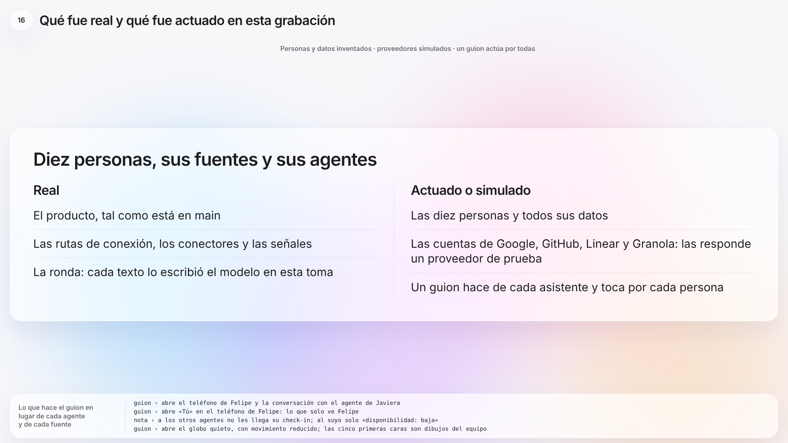

# Diez personas, sus fuentes y sus agentes

[diez-personas.mp4](diez-personas.mp4) · 2 min 52 s · 1920 × 1080 · grabado el 21-nov-2026 · toma 2 de 2 · variante V2

Una persona conecta sus fuentes de tres formas (un envío, una cuenta y una llave) y su asistente. Después hay diez personas en la sala, cada una con otra mezcla, y sus agentes conversan. Dentro de los marcos corre el producto real: a la izquierda la pantalla de la sala, a la derecha un teléfono y abajo lo que hace el guion en lugar de cada agente y de cada fuente. Las personas y sus datos son inventados, y el video lo dice en cada cuadro.



## Qué se ve

Los minutos salen de `pasos[].segundo` de [diez-personas.json](diez-personas.json).

| Minuto | Paso |
|---|---|
| 0:00 | 1. La pantalla de la sala «Equipo Quillay», con el QR y con Antonia adentro, todavía sin agente. |
| 0:02 | 2. En el teléfono de Antonia se crea la línea para su agente. El guion hace de su Claude Code: abajo quedan sus tres llamadas. En el teléfono aparecen el asistente y cuatro archivos, y en la sala, «Claude Code» bajo su nombre. |
| 0:16 | 3. Llega una noche de sueño a Apple Health. Antonia toca «Conectar» en Google Calendar, aparece una pantalla de permiso simulada y, al permitir, quedan conectados Google Calendar y Gmail. Abajo se lee un correo y una reunión que quedaron guardados. |
| 0:31 | 4. Granola entra con una llave escrita en el teléfono: «Conectado como antonia@ronda.example. 2 registros nuevos.» |
| 0:42 | 5. Check-in desde el teléfono: «Normal» y, como bloqueo, «guion y ensayo del pitch». |
| 0:54 | 6. En «Tú», la fila «Carga» dice «Carga alta hoy» y de dónde sale: Google Calendar y Granola. |
| 0:59 | 7. En «Equipo», su agente pregunta «¿Pido ayuda con «guion y ensayo del pitch»?». Antonia toca «Permitir». |
| 1:06 | 8. Entran nueve personas más. El registro dice con qué asistente y con qué fuentes llega cada una. En la sala quedan diez nombres, ocho tipos de asistente y una persona sin agente. |
| 1:26 | 9. Antonia inicia la ronda y los agentes conversan. Este tramo va acelerado ×6; el reloj muestra el tiempo real. |
| 1:33 | 10. Dos personas pueden ayudar a Antonia. Ella lee lo que conversó su agente y acepta la propuesta; el guion acepta por Fernanda y Nicolás, y la propuesta queda «Acordada». |
| 1:56 | 11. El teléfono de Ignacio: su bloqueo «Sin avances en «Conciliación de cobros con el banco» desde hace 4 días» sale de Linear. Nadie lo escribió. La escena termina en su conversación con el agente de Catalina, que dice «Puede orientar». |
| 2:09 | 12. La conversación entre el agente de Javiera y el de Felipe: dijo que no puede y no dio la razón. |
| 2:22 | 13. El teléfono de Felipe: «Energía baja hoy», que sale de su check-in («Con cansancio»). Esa frase la ve solo él. |
| 2:31 | 14. Su agente usa esa frase para decidir y a los otros agentes no les llega. |
| 2:35 | 15. De 45 conversaciones posibles, los agentes tuvieron 5. La misma sala en el globo, con un arco por conversación. |
| 2:45 | 16. Qué fue real y qué fue actuado en esta grabación. |

Esta toma: variante V2, 5 conversaciones y 3 propuestas. Antonia con Fernanda y Nicolás: acordada. Javiera con Cristóbal: acordada (el guion acepta por las dos personas). Ignacio con Catalina: queda por aprobar, porque el agente de Catalina solo ofreció orientar. La ronda tardó 20 s reales y usó 19 llamadas al modelo. Los dos mensajes de la conversación que se muestra están en `hiloElegido`, dentro de `diez-personas.json`:

- Agente de Javiera: «Javiera necesita a alguien que sepa de animación en canvas para que los arcos del mapa de la sala se muevan con fluidez. Te escribo porque optimizas gráficos y tienes animación en canvas entre tus temas. ¿Puedes ayudarla?»
- Agente de Felipe: «Gracias por escribir. Felipe conoce animación en canvas, pero ahora no tiene disponibilidad para hacerse cargo, así que no puede ayudar a Javiera con esto.»

La respuesta no da causa: ni cansancio, ni sueño, ni reuniones.

## Qué es real y qué no

**Real**

- El producto: el frontend y el backend de `main`, sin cambios, corriendo en un computador.
- La línea para el agente, el canje del código, el repo y el permiso de cada archivo.
- El código de conexión de cada fuente: el inicio y la vuelta del permiso, el guardado cifrado del acceso, el formulario de la llave de Granola, la ruta de Apple Health, los conectores, los registros y las frases que salen de ellos.
- El check-in de Antonia, la pregunta «¿Pido ayuda con…?» y su «Permitir»: toques sobre el producto, en un marco del tamaño de un teléfono.
- Que una tarea de Linear detenida se vuelve un pedido sin que nadie lo escriba.
- La ronda: qué agente le escribe a cuál, cada respuesta y cada propuesta las escribió el modelo en esa toma. Nada de eso está guionado.
- Que el agente de Felipe recibió solo «disponibilidad: baja». Ningún mensaje entre agentes lleva su check-in, horas de sueño ni reuniones: el código no los pone. Lo mismo vale para Catalina, cuyo agente respondió «Puede orientar».

**Inventado o actuado**

- Las diez personas, sus repos, reuniones, correos, notas, tareas, commits, check-ins y horas de sueño. Salen de una lista escrita a mano (`tools/grabar/elenco2.mjs`). No son personas reales.
- No se conectó ninguna cuenta real de Google, GitHub, Linear ni Granola. Un proveedor simulado, dentro del servidor de demo, respondió cada llamada. Las cuentas `…@ronda.example` y los repos `ronda-demo/…` no existen.
- La pantalla de permiso es simulada. No es la de Google.
- El dato de Apple Health lo mandó el guion, en el formato del «Atajo mínimo» (un solo número de sueño, sin fecha). El Atajo compartido nuevo manda un lote de varios días; ese no se mostró. No hubo iPhone.
- Un solo guion hizo de las diez personas y de sus asistentes. No corrió ninguna sesión de Claude Code, Codex, Cursor ni OpenClaw, y los textos «pegados» de ChatGPT, Grok, Claude y Gemini los escribimos nosotros.
- Nueve personas se crearon y se conectaron antes de grabar. En cámara solo entran a la sala. Sus aceptaciones las mandó el guion.
- El correo queda conectado y guarda asunto y remitente. Hoy no alimenta ninguna señal y ningún agente lo lee.
- La disponibilidad no se muestra en ninguna pantalla del producto. El video muestra las frases de donde sale y la respuesta del agente.
- En el globo, las cinco primeras caras son las ilustraciones del equipo, bajo nombres inventados. El globo se grabó quieto (movimiento reducido), para que no aparezca la marca «Listo», que es una animación y no un estado.

**Ediciones del video**

- El tramo de la ronda va acelerado ×6. La ronda tardó 20 s reales; el reloj en pantalla los muestra.
- Las esperas con la pantalla quieta se cortaron a 1,2 s (10 esperas, 7,4 s en total), y la recarga del teléfono después del permiso no se muestra (0,6 s).
- Tomas: se grabaron 2. Esta es la toma 2. La toma 1 tuvo la misma variante (V2) y pasó todas las puertas, pero duró 431 s: el computador donde se grabó no tiene GPU, la lava de las caras corría por software y cada paso del guion tardaba unos 230 ms en vez de 7. No se armó el video.
- La toma 2 se grabó con `--sin-webgl`: el navegador no tiene WebGL, así que las caras muestran su mezcla de colores quieta (los ojos siguen vivos) en vez de la lava en movimiento. Es el mismo respaldo que tiene el producto en un equipo sin WebGL2. El globo se dibuja igual.

**El servidor de demo**

- Es `tools/grabar/servidor-demo.mts`, no el arranque del producto. Usa el mismo código y cambia cuatro cosas: las respuestas de los proveedores, la pantalla de permiso, la ronda automática de las 9:00 (apagada) y el modelo (fijo).
- Reintenta una vez una llamada al modelo que falla y hace una llamada de calentamiento al partir. El producto no hace ninguna de las dos. En esta toma no hubo reintentos ni llamadas fallidas.
- Tampoco vuelve a sincronizar las fuentes cada 15 minutos, deja apagado el puente de WhatsApp y escucha solo en `127.0.0.1`.
- En la escena 2 se lee en el teléfono la línea para el agente (`localhost:8797/a/…`). Sirve una vez y dura 15 minutos; el guion la canjeó en la misma escena y ese servidor ya no existe. Ningún link personal (`/conectar/…`) ni dirección de Apple Health aparece en pantalla, en el registro ni en el JSON.

**Con qué modelo y dónde**

- Claude Sonnet (`claude-sonnet-5-5`) por la terminal (`claude`): 19 llamadas en la ronda y 20 desde que partió el servidor, contando el calentamiento. En `localhost`, no en producción. 50x sigue sin probarse.
- La grabación la corrió Claude en una sesión de Claude Code en la nube, sobre el commit `b78e3ae` (el producto es el mismo de `298419a`: entre los dos solo cambió el guion de grabación).

## Cómo volver a grabar

Hace falta Node 22, `ffmpeg` y la terminal `claude` con sesión iniciada. Un solo proceso pesado a la vez: no se corre un ensayo junto con una toma, ni dos servidores.

```bash
nvm use
npm run build

# Las pruebas, sin servidor, sin navegador y sin modelo
node --test tools/grabar/tiempos2.test.mjs tools/grabar/preparar2.test.mjs
npx tsx --test tools/grabar/proveedor-demo.test.mts tools/grabar/servidor-demo.test.mts

# 1. El servidor de demo, con una carpeta de datos nueva y fuera del repo
DATA_DIR="$(mktemp -d)" PORT=8797 DEMO_COMMIT="$(git rev-parse --short HEAD)" npx tsx tools/grabar/servidor-demo.mts

# 2. Un ensayo: el guion completo con una ronda real, sin navegador y sin video
node tools/grabar/preparar2.mjs --ensayo --parcial-vale

# 3. La toma. Antes se reinicia el servidor con otro DATA_DIR
node tools/grabar/grabar2.mjs --base http://localhost:8797 --out docs/demo/diez-personas.mp4 --frames "$(mktemp -d)" --capturas "$(mktemp -d)" --parcial-vale --toma 1   # + --sin-webgl si no hay GPU
```

Opciones de `grabar2.mjs`:

| Opción | Por defecto | Qué hace |
|---|---|---|
| `--base` | `http://localhost:8797` | Dónde está el servidor de demo. |
| `--out` | `docs/demo/diez-personas.mp4` | El video. Al lado deja el `.png` del último cuadro y el `.json` con el resumen. |
| `--frames` | una carpeta nueva en la carpeta temporal del sistema | Dónde quedan los cuadros. Tiene que estar vacía y fuera del repo. El guion no la borra. |
| `--capturas` | ninguna | Si se indica, deja una imagen por escena (`e01.png`, `e02.png`…) en esa carpeta, vacía y fuera del repo. |
| `--permiso` | `pantalla` | Con `api`, el guion autoriza Google por Antonia sin mostrar la pantalla de permiso, y lo dice en el registro. |
| `--sin-globo` | apagada | La escena 15 se queda en la pantalla de la sala. |
| `--sin-webgl` | apagada | Abre el navegador sin WebGL. Para un computador sin GPU, donde la lava de las caras alarga la toma: sin WebGL las caras quedan con su mezcla quieta. |
| `--parcial-vale` | apagada | Acepta la variante V3, en que el agente de Catalina solo ofrece orientar. |
| `--toma` | `1` | El número de la toma. Queda en el resumen. |
| `--max-segundos` | `170` | Si el video pasa de ese largo, no se arma y el resumen queda con `publicable: false`. Los cuadros y la lista que lee ffmpeg (`lista.txt`) quedan en la carpeta de cuadros. |

El guion no pisa una toma publicable. Si junto a `--out` ya hay un resumen con `publicable: true`, se detiene antes de empezar: para grabar otra toma se mueven el video, la captura y el resumen de la anterior, o se usa otro `--out`.

Si una toma quedó sobre `--max-segundos` y se decide usarla igual, el video se arma desde la carpeta de cuadros con el mismo comando que usa el guion:

```bash
ffmpeg -f concat -safe 0 -i <carpeta de cuadros>/lista.txt -vf fps=30,format=yuv420p -c:v libx264 -crf 22 -preset medium -movflags +faststart docs/demo/diez-personas.mp4
```

Qué revisar antes de publicar una toma:

- El resumen dice `publicable: true`. Si dice `false`, `motivo` explica por qué: una puerta de la ronda no pasó, la grabación se detuvo o el video quedó muy largo.
- Una persona lee los dos mensajes de `hiloElegido`. Si la respuesta da una causa (sueño, cansancio, reuniones o agenda), la toma no se publica y se avisa como un hallazgo del producto.
- Cada imagen de `--capturas`: nada cortado por la barra de pestañas, ningún «Cargando…» y ningún link personal en pantalla.
- No se graba entre las 23:30 y las 00:30. Los datos del elenco se calculan con el día en que parte el servidor; después de medianoche se reinicia con un `DATA_DIR` nuevo.

Los prompts y el código del producto no se cambian para que la demo resulte. Si después de cuatro tomas ninguna variante es publicable, se detiene y se conversa.
